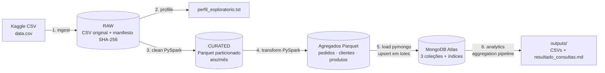

# Pipeline de Big Data: Transações de E-commerce (UK) → MongoDB Atlas

Implementação da **N3**: pipeline de ingestão em lote especificado na N2, com **PySpark** para
limpeza/transformação e **MongoDB Atlas** como destino analítico.

- **Disciplina / Avaliação:** N3 — Big Data
- **Integrantes:** _preencher_
- **Fonte de dados:** [E-Commerce Data (Kaggle, `carrie1/ecommerce-data`)](https://www.kaggle.com/datasets/carrie1/ecommerce-data) — ~540 mil linhas de transações de uma loja online do Reino Unido (dez/2010 a dez/2011)

---

## 1. Visão geral da solução



| Etapa | Módulo | O que faz | Saída |
|---|---|---|---|
| 1. Captura | `src/ingest.py` | Garante o CSV na camada RAW (Kaggle CLI ou manual) e registra hash/tamanho | `data/raw/data.csv`, `_manifesto.json` |
| 2. Exploração | `src/profile.py` | Nulos, preços zerados, cancelamentos, duplicados, países | `outputs/perfil_exploratorio.txt` |
| 3. Limpeza | `src/clean.py` | Remove duplicados, tipa dados, normaliza país/texto, cria flags | `data/curated/` (Parquet), `outputs/relatorio_qualidade.json` |
| 4. Transformação | `src/transform.py` | Monta `pedidos` (itens embutidos), `clientes`, `produtos` | `data/aggregates/` (Parquet) |
| 5. Carga | `src/load.py` | Upsert por `_id` em lotes de 1000 + índices + conferência de contagem | Coleções no Atlas, `outputs/relatorio_carga.json` |
| 6. Consultas | `src/analytics.py` | Executa as consultas da N2 e salva as evidências | `outputs/*.csv`, `outputs/resultado_consultas.md` |

### Regras de qualidade aplicadas (da N2)

- **Duplicados:** linhas idênticas são removidas.
- **Cancelamentos:** `InvoiceNo` começando com `C` → `cancelado = true` (quantidade negativa mantida).
- **Cliente não identificado:** `CustomerID` nulo → `cliente_identificado = false`; o pedido continua existindo, mas não entra em `clientes`.
- **Serviços:** `POST`, `D`, `DOT`, `M`, `S`, `B`, `BANK CHARGES`, `AMAZONFEE`, `CRUK`, `C2`, `PADS` → `eh_servico = true` e ficam fora dos agregados.
- **Suspeitos:** preço zero/negativo ou valores inválidos → `suspeito = true` (sinalizados, não apagados da camada curated).
- **Normalização:** `EIRE → Ireland`, `RSA → South Africa`, `USA → United States`; espaços extras removidos.
- **Codificação:** o CSV do Kaggle é **Latin-1** (`ISO-8859-1`); lido com essa codificação para não corromper acentos.

### Modelo de dados no MongoDB

**`pedidos`** — um documento por fatura, itens embutidos (`_id` = número da fatura)

```json
{
  "_id": "536365",
  "data_hora": "2010-12-01T08:26:00Z",
  "cliente_id": 17850,
  "pais": "United Kingdom",
  "cancelado": false,
  "itens": [
    { "codigo_produto": "85123A", "descricao": "WHITE HANGING HEART T-LIGHT HOLDER",
      "quantidade": 6, "preco_unitario_gbp": 2.55, "valor_item_gbp": 15.3 }
  ],
  "total_itens": 7,
  "valor_total_gbp": 139.12
}
```

**`clientes`** — `_id` = `CustomerID`: `pais`, `total_pedidos`, `valor_total_gbp`, `primeira_compra`, `ultima_compra`, `total_cancelamentos`.
**`produtos`** — `_id` = `StockCode`: `descricao`, `quantidade_vendida`, `receita_gbp`, `total_devolvido`.

`data_hora` é gravado como **BSON Date** (e não como texto), o que permite filtros e agrupamentos por data direto no MongoDB.

**Índices criados:** `pedidos` (`data_hora`, `cliente_id`, `pais`, `itens.codigo_produto`), `clientes` (`valor_total_gbp`), `produtos` (`quantidade_vendida`).

---

## 2. Como executar

### 2.1 Pré-requisitos

| Item | Versão | Observação |
|---|---|---|
| Python | 3.10+ | |
| **Java (JDK)** | **17** (ou 11/21) | Obrigatório para o PySpark. Confira com `java -version`. |
| Git | qualquer | |
| Conta no MongoDB Atlas | gratuita (M0) | Veja 2.3 |
| Dataset do Kaggle | `data.csv` | Veja 2.4 |

### 2.2 Instalação

```bash
git clone <URL-DO-SEU-REPOSITORIO>
cd ecommerce-pipeline

python -m venv .venv
source .venv/bin/activate          # Windows (PowerShell): .venv\Scripts\Activate.ps1
pip install -r requirements.txt
```

### 2.3 Configurar o MongoDB Atlas

1. Em [cloud.mongodb.com](https://cloud.mongodb.com), crie um cluster **M0 (Free)**.
2. **Database Access** → *Add New Database User* (usuário e senha; permissão *Read and write to any database*).
3. **Network Access** → *Add IP Address* → o seu IP atual (ou `0.0.0.0/0` apenas durante a apresentação).
4. **Connect → Drivers** → copie a *connection string* (`mongodb+srv://...`).
5. Crie o arquivo `.env` a partir do modelo e cole a string (troque `<usuario>` e `<senha>`):

```bash
cp .env.example .env        # Windows: copy .env.example .env
```

> O `.env` está no `.gitignore`. **Nunca** envie usuário/senha para o GitHub.

### 2.4 Obter o dataset

Baixe `data.csv` em <https://www.kaggle.com/datasets/carrie1/ecommerce-data> e salve em `data/raw/data.csv`.
(Alternativa: com a Kaggle CLI configurada, a etapa `ingest` baixa sozinha.)

### 2.5 Rodar o pipeline completo

```bash
python run_pipeline.py
```

Opções úteis:

```bash
python run_pipeline.py --etapas clean transform load   # só algumas etapas
python run_pipeline.py --recriar                       # apaga e recria as coleções antes da carga
python run_pipeline.py --amostra                       # demo com dados sintéticos, em banco separado (*_amostra)
```

A carga usa *upsert* pelo `_id`: **rodar duas vezes não duplica dados**.

### 2.6 Rodar os testes (sem internet e sem Atlas)

```bash
pip install -r requirements-dev.txt
pytest -s
```

O teste gera dados sintéticos, roda as 6 etapas com PySpark contra um MongoDB simulado (`mongomock`) e confere regras
como "serviços não viram produto", "preço zero não entra no pedido" e "reexecutar a carga não duplica".

---

## 3. Saídas esperadas

Depois de `python run_pipeline.py`, a pasta `outputs/` contém as evidências:

| Arquivo | Conteúdo |
|---|---|
| `perfil_exploratorio.txt` | Diagnóstico do CSV bruto (nulos, preços zerados, cancelamentos, duplicados…) |
| `relatorio_qualidade.json` | Contagens da limpeza: lidas, duplicadas removidas, sem cliente, serviços, suspeitas, período |
| `relatorio_carga.json` | Por coleção: documentos no Parquet × no MongoDB (`confere: true`), novos/atualizados, índices |
| `resultado_consultas.md` + `0X_*.csv` | Resultado das consultas analíticas |

**No Atlas** (aba *Browse Collections*, banco `ecommerce_uk`): 3 coleções — `pedidos`, `clientes`, `produtos` — com os índices listados.

**Sobre o dataset real**, valores de referência conhecidos do arquivo original (confira com o seu `perfil_exploratorio.txt`):
≈ 541.909 linhas · 8 colunas · ≈ 135 mil linhas sem `CustomerID` (~25%) · ≈ 1,4 mil sem descrição · ≈ 4,4 mil clientes · ≈ 38 países.
O número de documentos em `pedidos` fica abaixo das ~25,9 mil faturas porque faturas só com serviços ou preço zero não viram pedido.

**Exemplo de saída das consultas** (rodando com `--amostra`, dados sintéticos — com o dataset real os números serão outros):

```
=== RECEITA POR MES ===
    mes  pedidos  receita_gbp
2010-12       70     10742.14
2011-01       58     10825.98
...
=== TOP PRODUTOS DEZ2010 ===
codigo_produto                           descricao  quantidade  receita_gbp
        84029G KNITTED UNION FLAG HOT WATER BOTTLE         330      1118.70
         22386             JUMBO BAG PINK POLKADOT         227       472.16
...
```

### Consultas implementadas

1. Receita e número de pedidos por mês (apenas não cancelados)
2. Top 10 países por receita
3. Top 10 produtos mais vendidos em dez/2010 e dez/2011 (`$unwind` nos itens embutidos)
4. Clientes com mais de 20 pedidos e valor total > £5.000
5. Taxa de cancelamento por país (países com ≥ 20 pedidos)
6. Produtos mais devolvidos

---

## 4. Estrutura do repositório

```
ecommerce-pipeline/
├── run_pipeline.py            # orquestrador (CLI)
├── requirements.txt / requirements-dev.txt
├── .env.example               # modelo de configuração (o .env real NÃO vai pro Git)
├── src/
│   ├── config.py  spark_session.py  mongo.py
│   ├── ingest.py  profile.py  clean.py  transform.py  load.py  analytics.py
├── scripts/gerar_amostra.py   # CSV sintético no formato do Kaggle (testes/plano B)
├── tests/test_pipeline.py     # teste ponta a ponta
├── docs/ROTEIRO_APRESENTACAO.md
├── data/                      # raw/ curated/ aggregates/ (ignorados pelo Git)
└── outputs/                   # evidências geradas (podem ser versionadas)
```

## 5. Problemas comuns

| Sintoma | Causa provável | Solução |
|---|---|---|
| `JAVA_HOME is not set` / `Java gateway process exited` | Java não instalado | Instale o JDK 17 e confira `java -version` |
| Erro ao gravar Parquet no **Windows** (`winutils`, `HADOOP_HOME`) | Spark no Windows exige binários do Hadoop | Use **WSL2/Ubuntu** (recomendado) ou configure `winutils.exe` + `HADOOP_HOME` |
| `Não foi possível conectar ao MongoDB Atlas` | IP não liberado ou senha errada | Atlas → *Network Access* e confira a `MONGO_URI` (senha com caracteres especiais precisa ser *URL-encoded*) |
| `OutOfMemoryError` | Pouca RAM | Reduza `SPARK_DRIVER_MEMORY` ou feche outros programas |
| Acentos quebrados | CSV lido como UTF-8 | O pipeline já lê como Latin-1; não salve o CSV de novo pelo Excel |

## 6. Limitações e evoluções

- Execução **em lote** (batch) em Spark local; em produção o mesmo código roda em cluster (YARN/Databricks/EMR).
- Ingestão manual/CLI do Kaggle; poderia ser agendada (Airflow/cron) para carga incremental.
- Possíveis extensões: segmentação RFM de clientes, índices de texto em `produtos.descricao`, dashboard (Atlas Charts).
